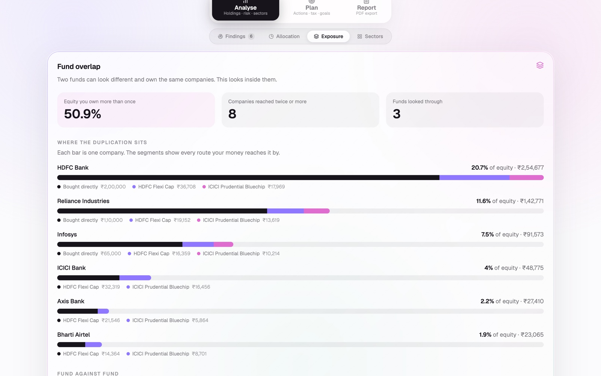
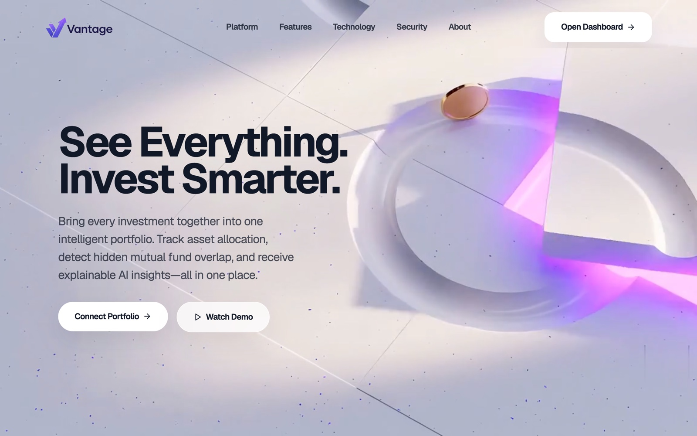

# Vantage

**Portfolio intelligence for Indian retail investors.** Consolidates holdings across brokers,
mutual funds, EPF, bonds, gold, REITs and InvITs — then looks *inside* the funds, down to the
individual companies, to show what you are actually holding underneath.

> Prototype using synthetic data. Every holding, value and folio number in this repository is
> invented for demonstration. Vantage is a read-only analysis layer — it never holds, moves or
> manages money, and it is not a registered investment adviser.


---

## The problem it solves

Two funds can carry different names, different mandates and different fund houses, and still
own substantially the same companies. That duplication is invisible at the fund level, and it
is the risk retail investors are least equipped to see.

In the bundled demo portfolio, HDFC Bank is reached three ways — bought directly, held inside
HDFC Flexi Cap, and held inside ICICI Prudential Bluechip. Counting only directly held shares,
it looks like **16.3%** of equity. Looking through the funds, the real figure is **20.7%**.

Two of that portfolio's funds are **38.7% the same book of stocks**.



*Each bar is one company; the segments are every route the money reaches it by.*

Group those companies by the industry they operate in, and a concentration appears that the
investor never consciously chose — 30.4% of equity in financial services, spread across seven
companies reached through three funds plus direct holdings.


## What makes the numbers trustworthy

Every score is arithmetic on disclosed inputs. There is no trained model anywhere in the
analytics path, and every figure can be re-derived by hand from
[`docs/METHODOLOGY.md`](docs/METHODOLOGY.md), which documents each formula and works a full
example end to end.

Three design rules the code actually holds to:

- **Explanation travels with the number.** Every computed object carries a `why` string
  generated alongside the value, so the UI never reconstructs the reasoning.
- **Understate rather than overstate.** Fund factsheets disclose top holdings, not the complete
  book. Coverage is reported explicitly (42.1% in the demo portfolio) and every overlap figure
  is a floor — at least this much duplication, never less.
- **The AI explains, never calculates.** The language model receives finished numbers and is
  constrained from producing new ones, forecasting returns, or naming any security.

## Running it

```bash
npm install
npm run dev
```

Open <http://localhost:3000>.

The AI narrative panel on `/dashboard` needs an Anthropic API key — copy `.env.example` to
`.env` and fill it in. Everything else runs without one.

PDF export uses Puppeteer, which needs a matching Chrome build:

```bash
npx puppeteer browsers install chrome
```

## Routes

| Route | What it does |
|---|---|
| `/` | Landing page |
| `/connect` | Account Aggregator / CAS upload / manual onboarding |
| `/dashboard` | The product — health score, findings, overlap, sectors, tax, goals |
| `/report` | Print-styled document rendered to PDF |
| `/api/analyze` | Runs the engine, returns the full analysis as JSON |
| `/api/narrate` | Streams the plain-language explanation |
| `/api/report` | Renders `/report` to a nine-section PDF |

| | |
|:--:|:--:|
|  |  |
| `/` — landing | `/connect` — consent-first onboarding |


*Findings ranked by severity. Every card opens to the arithmetic behind it.*

Four demo portfolios are bundled and produce genuinely different verdicts:

```
/dashboard?portfolio=aarav     health 70 good   · capacity 86 aggressive
/dashboard?portfolio=sunita    health 56 fair   · capacity 31 conservative
/dashboard?portfolio=meera     health 82 strong · capacity 63 moderate
/dashboard?portfolio=rohan     health 44 fair   · capacity 86 aggressive
```

## The analytics engine

Eleven pure modules under [`lib/analytics/`](lib/analytics), composed in a single pass by
`analysePortfolio()`.

| Component | File |
|---|---|
| Input / output schemas | `types/portfolio.ts` · `types/analysis.ts` |
| Fund asset mixes | `lib/analytics/fund-taxonomy.ts` |
| Risk capacity | `lib/analytics/risk-profile.ts` |
| Allocation and drift | `lib/analytics/allocation.ts` |
| Concentration and HHI | `lib/analytics/concentration.ts` |
| Look-through overlap, industries | `lib/analytics/overlap.ts` |
| Shape comparison | `lib/analytics/benchmark.ts` |
| What-if simulation | `lib/analytics/simulate.ts` |
| Health score | `lib/analytics/health-score.ts` |
| Findings | `lib/analytics/findings.ts` |
| Instrument matching | `lib/analytics/instrument-match.ts` |
| AI guardrails | `lib/ai/narrative-prompt.ts` |

## Known limitations

Stated plainly, because a methodology that only lists strengths is not a methodology. The full
table is in [`docs/METHODOLOGY.md`](docs/METHODOLOGY.md) §11 — the main ones:

- Factsheet coverage is partial, so overlap and issuer concentration are floors, not exact figures
- Factsheets are monthly, so look-through lags actual holdings by up to a month
- Reference allocations are conventional planning heuristics, not personalised targets
- No tax treatment is modelled in the allocation engine
- Risk capacity ignores income stability and existing insurance

## Stack

Next.js 15 · React 19 · TypeScript · Tailwind CSS 4 · Framer Motion · Recharts · Puppeteer ·
Anthropic SDK

**Data provenance.** Fund names, company names, ISINs, instrument names and exchanges are real.
Holding weights, yields, unit counts, folio numbers and portfolio values are synthetic and
labelled as such at the top of each data file.

## License

[MIT](LICENSE).
